# Automatic Image Colorization using Machine Learning

A classical, feature-based machine learning image colorization system that predicts chrominance channels ($U, V$) from a single grayscale luminance channel ($Y$) in OpenCV's YUV color space. The pipeline integrates **SLIC superpixel segmentation**, **local 2D Fast Fourier Transform (FFT) and luminance texture features**, **StandardScaler normalization**, **supervised regression (`RBF-SVR` and `ExtraTreesRegressor`)**, **Markov Random Field (MRF / ICM) spatial refinement**, and optional **bilateral edge-preserving chrominance smoothing** before reconstructing full RGB images.

---

## Table of Contents

1. [Project Objective](#1-project-objective)
2. [Problem Statement](#2-problem-statement)
3. [Key Features](#3-key-features)
4. [Complete Pipeline & Architecture](#4-complete-pipeline--architecture)
5. [Input and Output Image Gallery](#5-input-and-output-image-gallery)
6. [Algorithms and Techniques Used](#6-algorithms-and-techniques-used)
7. [Dataset Information](#7-dataset-information)
8. [Model Experiments and Comparison](#8-model-experiments-and-comparison)
9. [Evaluation Metrics](#9-evaluation-metrics)
10. [Installation and Setup](#10-installation-and-setup)
11. [How to Run the Project](#11-how-to-run-the-project)
12. [How to Train Models](#12-how-to-train-models)
13. [Running Automated Tests](#13-running-automated-tests)
14. [Project Directory Structure](#14-project-directory-structure)
15. [Limitations](#15-limitations)
16. [Future Improvements](#16-future-improvements)

---

## 1. Project Objective

- **Primary Objective:** Build an end-to-end, reproducible classical machine learning pipeline capable of automatically estimating plausible colors for grayscale nature photographs (forests, skies, mountains, lakes, rivers, and valleys) within modest CPU and memory budgets.
- **Engineering & Evaluation Objective:** Enforce strict source-image split isolation (zero data leakage), benchmark multiple regressor architectures and segmentation/smoothing configurations on an untouched test split, and transparently analyze domain boundaries and trade-offs relative to deep representation learning.

---

## 2. Problem Statement

Given only the single-channel grayscale luminance $Y(x, y) \in [0, 255]$ of an image, image colorization aims to reconstruct the missing two-channel chrominance components $U(x, y)$ and $V(x, y)$ so that combining $(Y, U, V)$ yields a natural-looking RGB image.

Colorization is an **inherently ambiguous, ill-posed inverse problem**: a single luminance texture or intensity level can legitimately map to many different valid colors in the real world (for instance, bright textured regions may correspond to white clouds, waterfall foam, snow, or stone; dark leafy textures may be green foliage, shadowed evergreens, or autumn brush). Classical local-feature regressors therefore cannot recover exact ground-truth colors deterministically—instead, they learn statistical associations between local luminance frequency/intensity patterns and plausible chrominance priors conditioned on neighborhood smoothness.

---

## 3. Key Features

- **End-to-End Classical Pipeline:** Modular CLI (`main.py`) covering preprocessing, SLIC superpixel segmentation, FFT feature extraction, feature scaling, U/V regression, MRF/ICM spatial smoothing, and quantitative RGB evaluation.
- **Boundary-Adaptive Superpixels:** Configurable SLIC compactness (`10.0` baseline grid vs. `0.2` / `0.1` contour-following superpixels) to align chrominance regions with natural object boundaries.
- **Dual Regressor Support:** Supports both classical **RBF Support Vector Regression (`SVR`)** and faster ensemble **Extremely Randomized Trees (`ExtraTreesRegressor`)** using a unified `feature_scaler.joblib` / `svr_u.joblib` / `svr_v.joblib` artifact contract.
- **Nature-Aware Domain Curation:** Filters auxiliary DIV2K images by green/blue chrominance presence ($\ge 30\%$) while anchoring 100% of original landscape training superpixels, eliminating indoor/urban red-shift bias.
- **Graph MRF & Bilateral Post-Processing:** Iterative Conditional Modes (ICM) smoothing over the superpixel adjacency graph plus optional `--smooth-chroma` bilateral filtering to soften superpixel border steps without blurring luminance edges.
- **Leakage-Free Verification:** Strictly splits datasets by source image, fits `StandardScaler` exclusively on training features, and includes automated unit and live-inference regression tests.

---

## 4. Complete Pipeline & Architecture

Every training, evaluation, and live inference execution (`main.py colorize`) follows this execution order verified in [`src/colorize.py`](src/colorize.py):

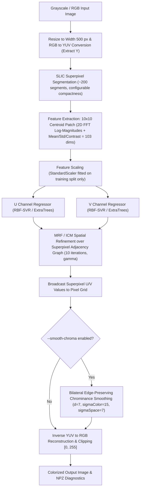

---

## 5. Input and Output Image Gallery

All images shown below are tracked in the repository and generated directly from the held-out `dataset/test/` split and live inference pipeline outputs.

### A. Original Grayscale Inputs, Ground Truth, and Baseline SVR Outputs

These examples show the grayscale luminance inputs (`outputs/grayscale/test/`), original color references (`dataset/test/`), and baseline SVR + MRF outputs (`outputs/final/test/` generated by `models/`):

| Scene | Original Grayscale Input ($Y$) | Ground-Truth Color Image | Baseline SVR + MRF Output (`models/`) |
|---|---|---|---|
| **Lake & Evergreen Shore (`r1`)** | 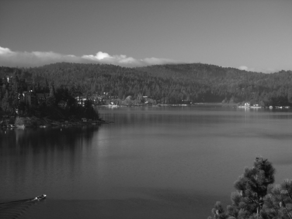 | 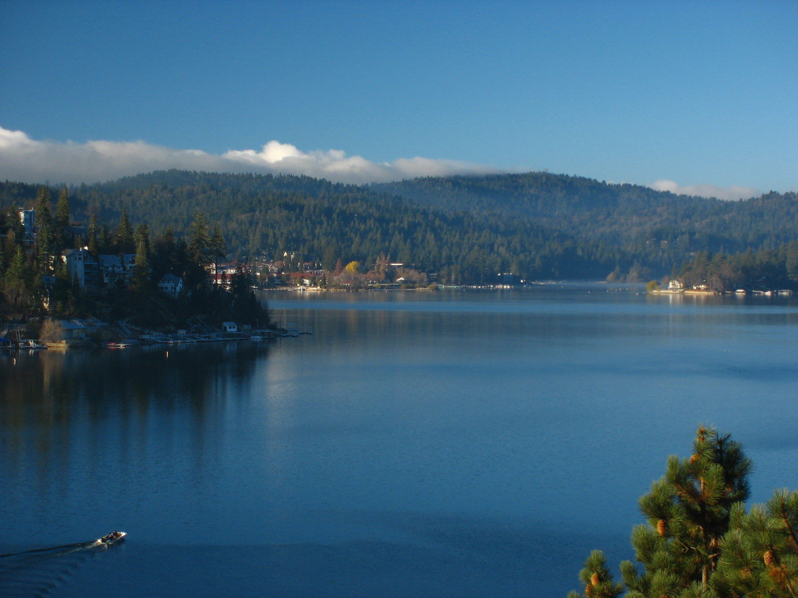 | 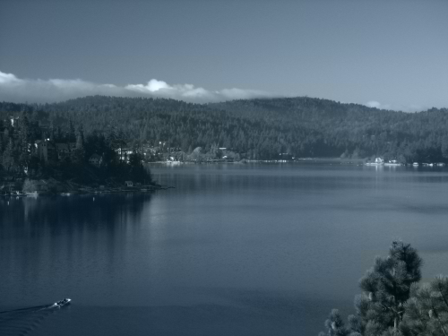 |
| **Sunny Lake & Clouds (`l2`)** | 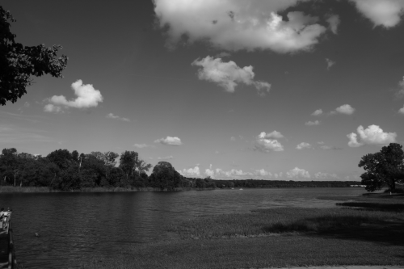 | 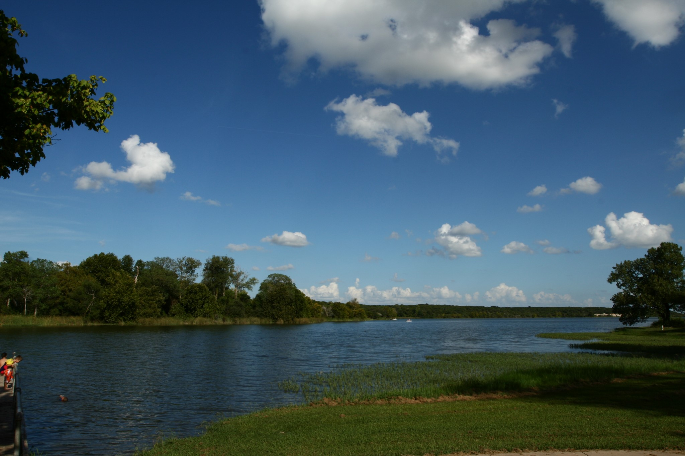 | 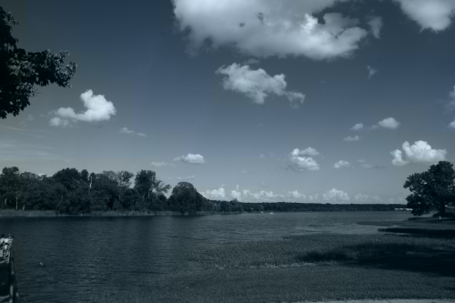 |
| **Mountain Lake (`m1`)** | 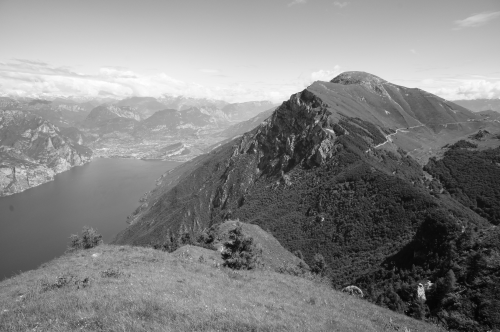 | 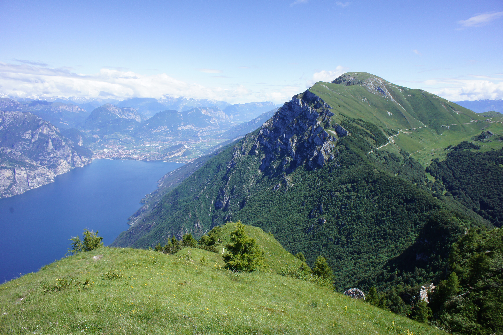 | 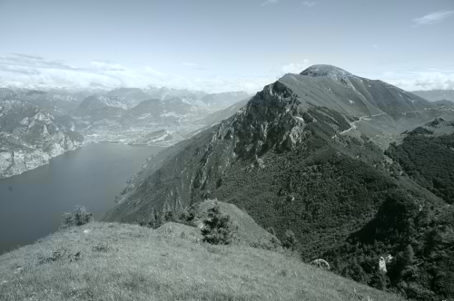 |
| **Alpine Valley (`m3`)** | 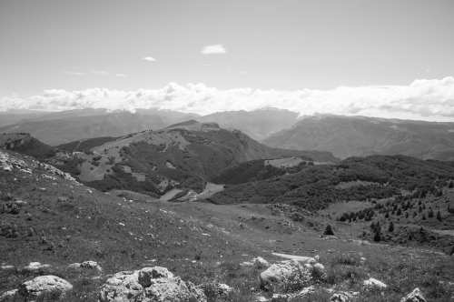 | 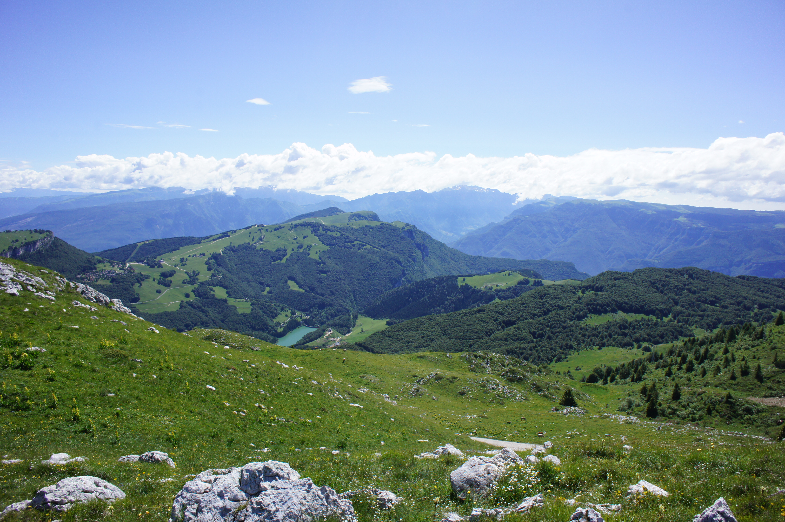 | 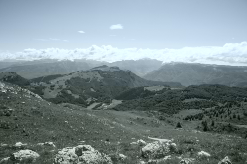 |

---

### B. Multi-Model Improvement Comparisons Across Nature Scenes

Each 4-way comparison panel (`outputs/final_solution/visual_comparisons/nature/`, generated by `scripts/generate_final_solution_artifacts.py`) places outputs side by side in progression:
**`1. Grayscale Input` → `2. Baseline SVR (models/, comp=10.0, gamma=2.0)` → `3. Nature-Aware SVR (models_sprint_svr_nature/, comp=0.2, gamma=0.2)` → `4. Nature-Aware ExtraTrees Benchmark (models_sprint_et_nature/, comp=0.2, gamma=0.2, piecewise)`**

> **Gallery configuration note:** Column 4 in every panel below renders the **benchmark piecewise ExtraTrees configuration** (`compactness=0.2, gamma=0.2`, **without** `--smooth-chroma`). Per-image MAE and PSNR figures cited beside these panels come from the sprint benchmark record ([`outputs/final_solution/results.json`](outputs/final_solution/results.json)), which is distinct from the quality-loop configuration (`compactness=0.1, gamma=0.1, --smooth-chroma`) reported separately in [Section 8](#8-model-experiments-and-comparison).

#### 1. Lake & Evergreen Shoreline (`r1.jpg`) — Best Quantitative Improvement (+5.07 dB PSNR over Baseline)
- **Baseline SVR MAE:** `14.462` → **Nature-Aware SVR MAE:** `9.963` → **Nature-Aware ExtraTrees MAE:** **`6.876`** (`27.940 dB` PSNR)
- The baseline predicts muted gray-blue across trees and water; both nature-aware models recover clear sky tones, rich lake blues, and green shoreline pines.

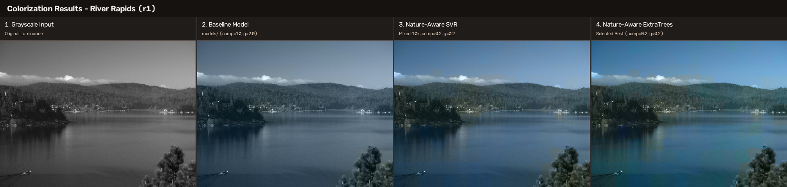

#### 2. Sunny Lake & Cumulus Clouds (`l2.jpg`)
- **Baseline SVR MAE:** `12.828` → **Nature-Aware SVR MAE:** **`8.585`** → **Nature-Aware ExtraTrees MAE:** `9.419` (`25.130 dB` PSNR)
- Restores saturated blue skies around crisp white clouds and green tree/grass tones relative to the desaturated baseline.

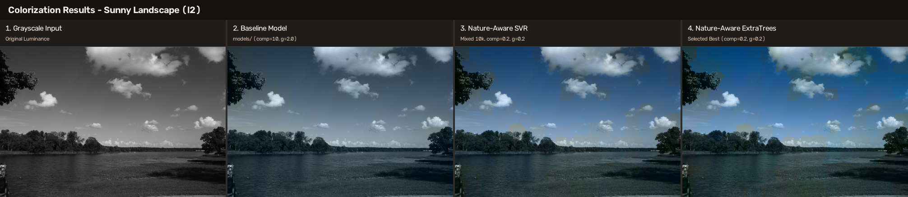

#### 3. Mountain Lake (`m1.jpg`)
- **Baseline SVR MAE:** `14.351` → **Nature-Aware SVR MAE:** **`12.888`** → **Nature-Aware ExtraTrees MAE:** `13.399` (`21.898 dB` PSNR)
- Separates slate-green forested slopes from open blue water without washing the lake in neutral gray.

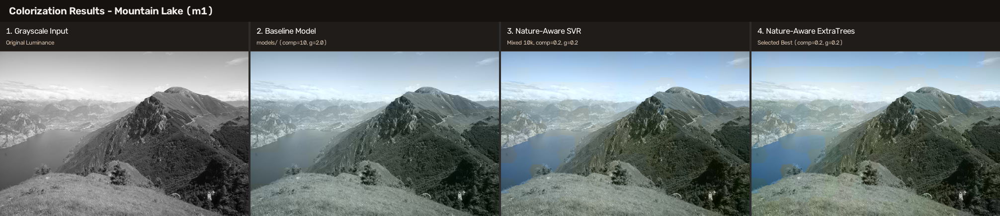

#### 4. Snowy Rocky Mountain Crags (`m2.jpg`)
- **Baseline SVR MAE:** `31.328` → **Nature-Aware SVR MAE:** `28.958` → **Nature-Aware ExtraTrees MAE:** **`27.071`** (`16.333 dB` PSNR)
- Shows both clearer alpine blue skies and the inherent difficulty of high-contrast snow/rock shadow regions.

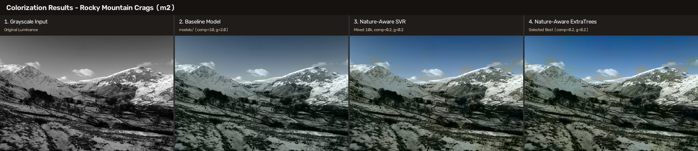

#### 5. Unseen Live Inference Image — Waterfall Landscape (`tree.jpg`, no ground truth in dataset)
- Demonstrates real unseen-image generalization: lowering SLIC compactness (`10.0 → 0.2`) and training on nature-aligned data removes rigid tiling and differentiates water, rock textures, and sky gradients.

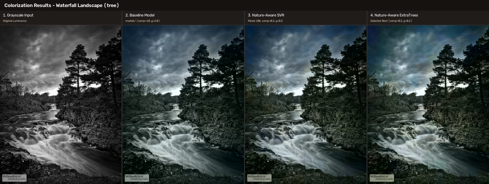

---

### C. Baseline Pipeline Stage Inspection (SLIC Grid & SVR vs. SVR+MRF)

These visualizations illustrate the intermediate segmentation grid (`outputs/segmentation/test/`) and the effect of baseline MRF spatial smoothing (`outputs/comparisons/test/`):

| SLIC Superpixels (`l2`, `compactness=10.0`) | 2x2 Baseline Pipeline Comparison (`l2`) | 2x2 Baseline Pipeline Comparison (`r1`) |
|---|---|---|
| 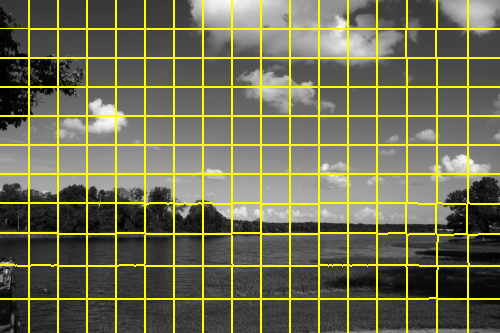 | 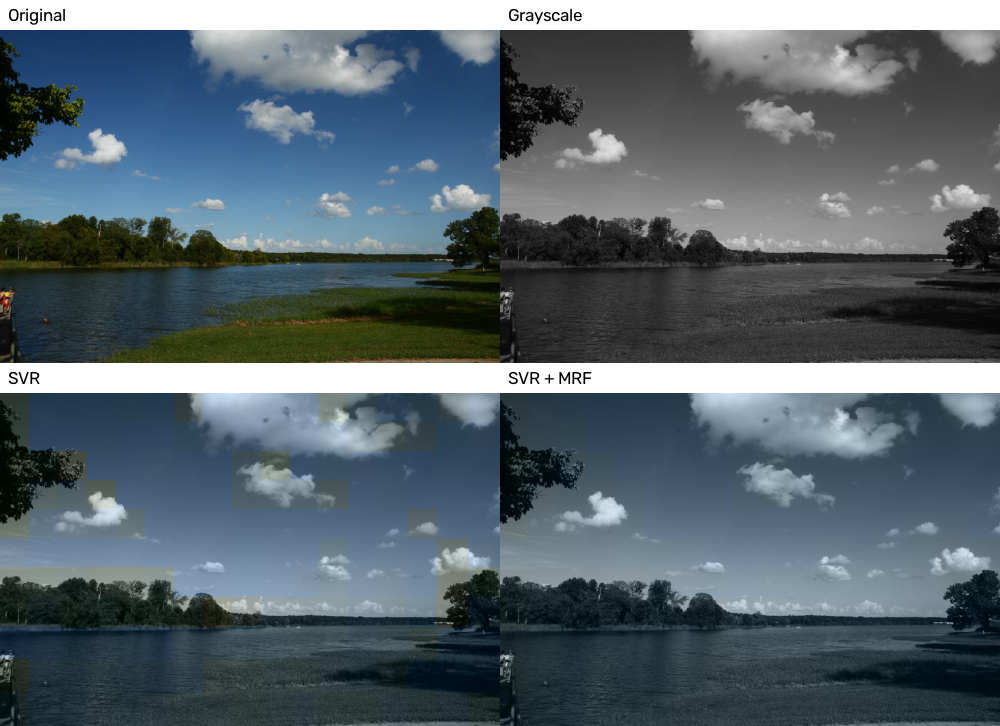 | 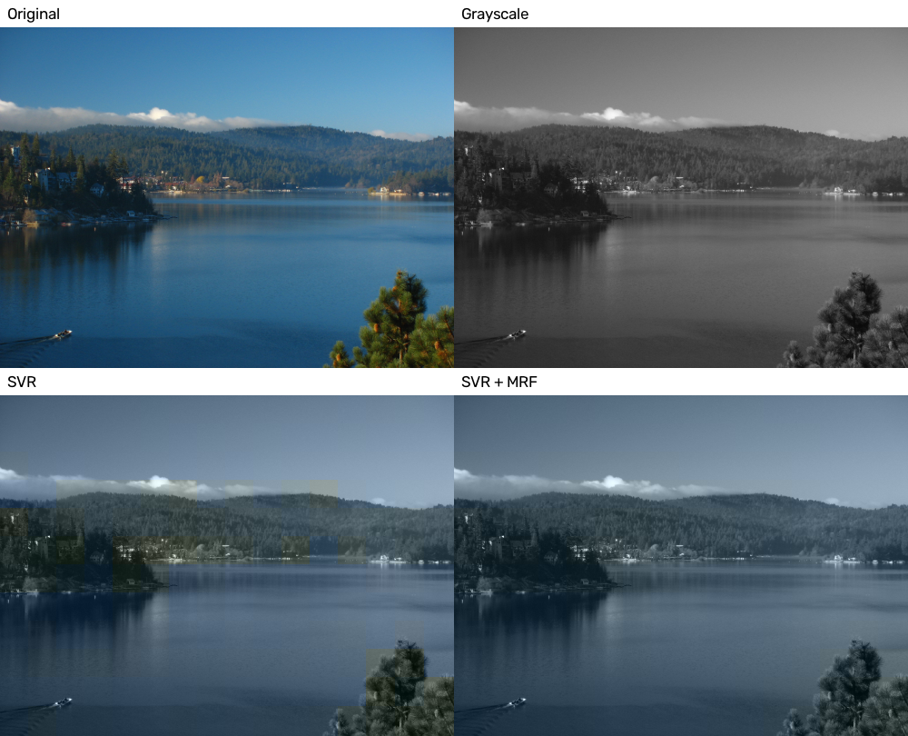 |

---

## 6. Algorithms and Techniques Used

1. **YUV Color Space (`src/preprocessing.py`, `src/colorize.py`):**
   - Separates achromatic luminance ($Y$) from chrominance ($U, V$) using OpenCV `COLOR_RGB2YUV` / `COLOR_YUV2RGB`.
   - In OpenCV uint8 encoding, neutral gray sits at $(U=128, V=128)$; $U > 128$ shifts toward blue/cyan while $V < 128$ shifts toward green (and $V > 128$ toward red/orange). Keeping $Y$ unmodified preserves original edge sharpness and brightness.
2. **SLIC Superpixel Segmentation (`src/segmentation.py`):**
   - Uses `skimage.segmentation.slic` (`n_segments=200`, `start_label=0`, single-channel luminance) to group perceptually coherent pixels, reducing regression from hundreds of thousands of pixels to ~200 superpixels per image.
   - Because luminance is scaled to $[0, 1]$ via `img_as_float`, lowering `compactness` from the baseline `10.0` (rigid squares) to `0.2` or `0.1` lets superpixels conform closely to clouds, treetops, and riverbanks.
3. **FFT Feature Extraction (`src/features.py`):**
   - For each superpixel, finds its geometric centroid and extracts a `10×10` reflection-padded luminance patch.
   - Computes shifted 2D FFT log-magnitudes `np.log1p(np.abs(np.fft.fftshift(np.fft.fft2(patch))))` flattened to **100 texture/frequency features**, concatenated with **3 local intensity statistics** (`mean`, `std`, `max - min` contrast), yielding a **103-dimensional feature vector** per superpixel.
4. **StandardScaler (`src/train.py`, `scripts/run_sprint_experiments.py`):**
   - Standardizes each of the 103 features to zero mean and unit variance. Fitted strictly on the training split only to prevent train/validation/test data leakage.
5. **Support Vector Regression (`RBF-SVR`):**
   - Trains two independent `sklearn.svm.SVR(kernel="rbf")` regressors—one for $U$ and one for $V$.
   - Baseline (`models/`): `C=0.125, epsilon=0.0625`. Nature-aware SVR (`models_sprint_svr_nature/`): increased regularization penalty `C=1.0, epsilon=0.0625` to prevent predictions from collapsing toward the global dataset mean.
6. **ExtraTrees Regression (`scripts/run_sprint_experiments.py`):**
   - Trains two `sklearn.ensemble.ExtraTreesRegressor(n_estimators=100, max_depth=15, n_jobs=-1, random_state=42)` models for $U$ and $V$.
   - Avoids SVR's $O(N^2)$ kernel matrix scaling (~2.5 s fit time on 10,000 samples vs. ~8.2 s for SVR) and captures nonlinear multi-modal color transitions in foliage, rock, water, and sky.
7. **MRF and ICM Refinement (`src/mrf.py`):**
   - Constructs a 4-connected superpixel adjacency graph from horizontal/vertical pixel label boundaries and minimizes the quadratic Markov Random Field energy:
     $$E(x) = \sum_{i} (x_i - p_i)^2 + \gamma \sum_{(i, j) \in \mathcal{E}} (x_i - x_j)^2$$
   - Runs **10 iterations** of Iterated Conditional Modes (ICM) with closed-form updates $x_i \leftarrow \frac{p_i + \gamma \sum_{j \in \mathcal{N}(i)} x_j}{1 + \gamma |\mathcal{N}(i)|}$ to enforce spatial consistency while removing isolated noisy superpixel predictions. Tuned $\gamma$ down from `2.0` (which over-smoothed colors) to `0.2` / `0.1`.
8. **Bilateral Chrominance Smoothing (`src/colorize.py`):**
   - Optional post-processing (`--smooth-chroma`) applies `cv2.bilateralFilter(..., d=7, sigmaColor=15, sigmaSpace=7)` to the broadcast pixel-level $U$ and $V$ maps before YUV→RGB reconstruction, reducing stepped superpixel border seams while respecting genuine color boundaries and keeping $Y$ untouched.

---

## 7. Dataset Information

| Dataset / Split | Source Path | Images | Superpixels | Role |
|---|---|---:|---:|---|
| **Original Train** | `dataset/train/` | 12 | 2,343 | Tracked landscape/nature training anchor |
| **Original Validation** | `dataset/validation/` | 3 | 561 | Hyperparameter tuning (`gamma`, `C`, `compactness`) |
| **Original Held-Out Test** | `dataset/test/` | 6 | 1,144 | Untouched evaluation benchmark (`l1`, `l2`, `m1`, `m2`, `m3`, `r1`) |
| **DIV2K Auxiliary Pool** | `DIV2K_train_HR/` *(ignored)* | 800 | 154,481 | Optional external high-res source (640 train / 160 val candidate split) |
| **Nature-Aware Mixed Train Set** | `dataset/train/` + filtered DIV2K | 252 | 10,000 | 2,343 original rows (100%) + 7,657 rows sampled from 240 nature-aligned DIV2K images ($\ge 30\%$ green/blue pixels) |

- All images are resized to `IMAGE_WIDTH = 500` pixels preserving aspect ratio.
- All train/validation/test splits are isolated at the **source-image file level** so superpixels from the same photograph never span across splits.

---

## 8. Model Experiments and Comparison

All reported benchmarks are verified across the untouched 6-image test set (`l1`, `l2`, `m1`, `m2`, `m3`, `r1`) using [`outputs/evaluation/test_metrics.csv`](outputs/evaluation/test_metrics.csv), the updated sprint evaluation (`scripts/run_sprint_experiments.py` -> `outputs/improvement_sprint/test_comparison_all_models.csv` & `summary_metrics.json`), and [`outputs/quality_loop/results.json`](outputs/quality_loop/results.json).

### Primary Configuration Comparison (4 Distinct Pipeline Settings)

| Configuration | Model Directory | Architecture & Training Data | SLIC / MRF / Post-Processing | MAE ↓ | MSE ↓ | RMSE ↓ | PSNR (dB) ↑ | Benchmark Source |
|---|---|---|---|---:|---:|---:|---:|---|
| **1. Baseline SVR** | `models/` | RBF-SVR ($C=0.125, \epsilon=0.0625$), 12 train images (2,343 rows) | `comp=10.0, gamma=2.0`, piecewise (no `--smooth-chroma`) | 16.912 | 708.801 | 24.648 | 20.833 | `test_metrics.csv`, sprint eval |
| **2. Nature-aware SVR** | `models_sprint_svr_nature/` | RBF-SVR ($C=1.0, \epsilon=0.0625$), 10k mixed nature rows | `comp=0.2, gamma=0.2`, piecewise (no `--smooth-chroma`) | 14.565 | 549.563 | 21.305 | 22.331 | Updated sprint eval |
| **3. Nature-aware ExtraTrees (Benchmark)** | `models_sprint_et_nature/` | ExtraTrees ($n=100, \text{depth}=15$), 10k mixed nature rows | `comp=0.2, gamma=0.2`, piecewise (no `--smooth-chroma`) | 14.184 | 509.095 | 20.659 | **22.599** | Updated sprint eval & `quality_loop/results.json` |
| **4. Nature-aware ExtraTrees (Quality Loop)** | `models_sprint_et_nature/` | ExtraTrees ($n=100, \text{depth}=15$), 10k mixed nature rows | `comp=0.1, gamma=0.1`, **`--smooth-chroma`** (`d=7, sigmaColor=15, sigmaSpace=7`) | **14.170** | — | — | 22.593 | `quality_loop/results.json` |

*Protocol & snapshot note:* `scripts/run_sprint_experiments.py` recomputes SLIC superpixels and FFT features at each candidate's requested `compactness`, yielding identical metrics (`14.184 MAE / 22.599 dB`) to `scripts/run_quality_loop_evaluation.py` for the `comp=0.2, gamma=0.2` ExtraTrees benchmark. MSE and RMSE are not logged in `outputs/quality_loop/results.json`. Historical snapshot artifacts in [`outputs/final_solution/results.json`](outputs/final_solution/results.json) and [`outputs/final_solution/FINAL_REPORT.md`](outputs/final_solution/FINAL_REPORT.md) predate that fix (`14.704` SVR / `14.324` ET from cached `comp=10.0` features).

### Additional Recorded Benchmarks

- **SLIC Compactness Tuning Experiment (`models_experiment_comp0.2/`, `comp=0.2, gamma=0.1`, piecewise):** MAE `16.610`, MSE `680.722`, RMSE `23.931`, PSNR `21.159 dB` (updated sprint evaluation at `comp=0.2`).
- **Unfiltered DIV2K-Only SVR (`models_div2k/`, `comp=10.0, gamma=2.0`, piecewise):** MAE `21.729`, MSE `1034.892`, RMSE `29.990`, PSNR `19.109 dB`. Training on unfiltered general DIV2K scenes shifted the $V$-channel prior toward warm indoor/brick colors ($V_{\text{mean}} = 130.5$), degrading nature test performance compared to the baseline.

Within this classical feature-based framework, **Nature-aware ExtraTrees (`models_sprint_et_nature/`)** achieves the lowest test MAE and highest PSNR: **+1.766 dB PSNR** (`-2.728` MAE) over the baseline under `comp=0.2, gamma=0.2` piecewise evaluation, and **+1.760 dB PSNR** (`-2.742` MAE) with noticeably smoother superpixel boundaries under the `comp=0.1, gamma=0.1, --smooth-chroma` quality-loop setting. These numbers quantify relative improvements within the local-feature pipeline on our landscape test split rather than claiming parity with modern deep colorization networks.

---

## 9. Evaluation Metrics

Evaluation (`src/evaluation.py`) compares reconstructed RGB output images $\hat{I}$ against resized ground-truth RGB images $I$ per image in `float32` over all $N = H \times W \times 3$ pixel channel values in $[0, 255]$:

- **MAE (Mean Absolute Error, ↓ lower is better):**
  $$\text{MAE} = \frac{1}{N} \sum |\hat{I} - I|$$
- **MSE (Mean Squared Error, ↓ lower is better):**
  $$\text{MSE} = \frac{1}{N} \sum (\hat{I} - I)^2$$
- **RMSE (Root Mean Squared Error, ↓ lower is better):**
  $$\text{RMSE} = \sqrt{\text{MSE}}$$
- **PSNR (Peak Signal-to-Noise Ratio in dB, ↑ higher is better):**
  $$\text{PSNR} = 10 \cdot \log_{10}\left(\frac{255^2}{\text{MSE}}\right)$$

### Dataset-Level Averaging & Chrominance Metrics

- **Unweighted Per-Image Averaging (`AVERAGE` rows):** All dataset summaries in [`outputs/evaluation/test_metrics.csv`](outputs/evaluation/test_metrics.csv), [`outputs/final_solution/results.json`](outputs/final_solution/results.json), and [`outputs/quality_loop/results.json`](outputs/quality_loop/results.json) compute each metric per image first and then take the **unweighted arithmetic mean across the 6 test images** (`l1`, `l2`, `m1`, `m2`, `m3`, `r1`). Because RMSE and PSNR are nonlinear functions of MSE, dataset-average RMSE is the mean of per-image RMSEs (for example, `24.648` for Baseline SVR rather than $\sqrt{708.801} = 26.623$), and dataset-average PSNR is the mean of per-image PSNRs (dB).
- **Superpixel `U MAE` / `V MAE`:** Sprint benchmark tables additionally log superpixel-level mean absolute error (`U MAE`, `V MAE`) between raw regressor predictions and ground-truth per-superpixel mean YUV chrominance prior to MRF refinement.

---

## 10. Installation and Setup

Requires **Python 3.12** (tested in `.venv` with `numpy`, `opencv-python`, `scikit-image`, `scikit-learn`, `joblib`, `matplotlib`).

```bash
# 1. Clone the repository
git clone https://github.com/vasanthreddy121/ml-mini-project.git
cd ml-mini-project

# 2. Create and activate a virtual environment
python3 -m venv .venv
source .venv/bin/activate

# 3. Install dependencies
python -m pip install --upgrade pip
python -m pip install -r requirements.txt
```

*(On Windows, activate using `.venv\Scripts\activate`.)*

> **Dependency Compatibility Note (`scikit-learn` 1.9.0 vs. 1.9.1):**
> [`requirements.txt`](requirements.txt) pins `scikit-learn==1.9.1` to match `.venv` and the tracked nature models (`models_sprint_svr_nature/*.joblib`, `models_sprint_et_nature/*.joblib`). Baseline `models/*.joblib` were saved under `scikit-learn==1.9.0`; `src/colorize.py:load_models()` filters only the benign `1.9.0 -> 1.9.x` patch-mismatch `InconsistentVersionWarning` when loading artifacts so saved models remain untouched and tests run cleanly.

---

## 11. How to Run the Project

Inspect all CLI arguments anytime with `python main.py --help`. Every live inference run writes output PNGs and NPZ diagnostics under `--output-dir/<input_stem>/` (default: `outputs/live/<input_stem>/`).

> **Note on tracked vs. local model directories:**
> `models/`, `models_sprint_svr_nature/`, and `models_sprint_et_nature/` are **tracked in Git** and work immediately after cloning. `models_experiment_comp0.2/` and `models_div2k/` are listed in `.gitignore` as large/intermediate experiment directories—they work locally once generated via training/experiment commands (see [Section 12](#12-how-to-train-models)).

### 1. Run Baseline Model (`models/`)
Uses default baseline settings (`COMPACTNESS=10`, `MRF_GAMMA=2.0`):
```bash
python main.py colorize --input tree.jpg --model-dir models
```

### 2. Run SLIC Experiment (`models_experiment_comp0.2/`)
Runs the contour-adaptive SLIC compactness `0.2` SVR experiment (requires local `models_experiment_comp0.2/`, benchmarked with `gamma=0.1`):
```bash
python main.py colorize \
  --input tree.jpg \
  --model-dir models_experiment_comp0.2 \
  --compactness 0.2 \
  --gamma 0.1
```

### 3. Run Nature-Aware SVR (`models_sprint_svr_nature/`)
Uses tuned nature-trained RBF-SVR ($C=1.0, \epsilon=0.0625$, piecewise superpixel output):
```bash
python main.py colorize \
  --input tree.jpg \
  --model-dir models_sprint_svr_nature \
  --compactness 0.2 \
  --gamma 0.2
```

### 4. Run Nature-Aware ExtraTrees (`models_sprint_et_nature/`, Recommended)
Choose between the two evaluated configurations for `models_sprint_et_nature/`:

- **Quality-Loop Configuration (`comp=0.1, gamma=0.1, --smooth-chroma`, recommended for smooth output):**
  ```bash
  python main.py colorize \
    --input tree.jpg \
    --model-dir models_sprint_et_nature \
    --compactness 0.1 \
    --gamma 0.1 \
    --smooth-chroma
  ```
- **Sprint Benchmark Piecewise Configuration (`comp=0.2, gamma=0.2`, no `--smooth-chroma`, matches Section 5B panels):**
  ```bash
  python main.py colorize \
    --input tree.jpg \
    --model-dir models_sprint_et_nature \
    --compactness 0.2 \
    --gamma 0.2
  ```

### 5. Run DIV2K-Only Model (`models_div2k/`, if locally generated)
Evaluates the general unfiltered DIV2K-trained SVR model (requires local `DIV2K_train_HR/` setup and `python main.py div2k-all` first):
```bash
python main.py colorize --input tree.jpg --model-dir models_div2k
```

---

## 12. How to Train Models

### Baseline Pipeline (`models/`)
Runs preprocessing, SLIC segmentation, FFT feature extraction, SVR training, test-split inference, MRF refinement, and evaluation end to end:
```bash
python main.py all
```
Or execute individual baseline stages:
```bash
python main.py preprocess
python main.py segment
python main.py features
python main.py train
python main.py colorize --split test
python main.py mrf --split test
python main.py evaluate --split test
```

### DIV2K Auxiliary Experiment (`models_div2k/`, `models_mixed_div2k/`)
Requires `DIV2K_train_HR/` PNG images present in the project root:
```bash
# Prepare, segment, extract features, train SVR, and evaluate on validation
python main.py div2k-all --div2k-limit 50 --div2k-max-train-samples 10000

# Mixed training & tuning workflows
python main.py mixed-tune
python main.py mixed-evaluate
```

### Nature-Aware Sprint Models (`models_sprint_svr_nature/`, `models_sprint_et_nature/`)
Requires prepared DIV2K caches under `outputs/div2k/` (from `div2k-prepare`, `div2k-segment`, `div2k-features`). Filters DIV2K nature scenes, constructs the 10,000-sample balanced training split, trains both `SVR` and `ExtraTreesRegressor`, benchmarks all models, and runs the quality-loop evaluation:
```bash
python scripts/run_sprint_experiments.py
python scripts/generate_final_solution_artifacts.py
python scripts/run_quality_loop_evaluation.py
```

---

## 13. Running Automated Tests

Run the verified colorization unit and integration tests (13 tests across 3 colorization test modules):
```bash
python -m unittest tests/test_div2k_experiment.py tests/test_live_colorize.py tests/test_sprint_models.py
```
Or discover all tests under `tests/`:
```bash
python -m unittest discover tests/
```

---

## 14. Project Directory Structure

```text
ml-mini-project/
├── main.py                                  # Unified pipeline and live-inference CLI
├── requirements.txt                         # Python package dependencies
├── README.md                                # Project documentation
├── tree.jpg                                 # Unseen sample waterfall input image
├── dataset/
│   ├── train/                               # 12 landscape training images
│   ├── validation/                          # 3 validation images
│   └── test/                                # 6 held-out test images (l1, l2, m1, m2, m3, r1)
├── src/
│   ├── config.py                            # Pipeline defaults (width, SLIC, SVR, MRF, DIV2K)
│   ├── preprocessing.py                     # Resizing & RGB -> YUV conversion
│   ├── segmentation.py                      # SLIC superpixel segmentation & previews
│   ├── features.py                          # 10x10 patch 2D FFT + intensity stat extractor (103 dims)
│   ├── train.py                             # StandardScaler + U/V SVR training
│   ├── colorize.py                          # Inference, optional bilateral smoothing, RGB rebuild
│   ├── mrf.py                               # Superpixel adjacency graph & MRF/ICM smoother
│   ├── evaluation.py                        # MAE, MSE, RMSE, PSNR computation & 2x2 panels
│   └── div2k_experiment.py                  # Isolated DIV2K & mixed-training experiments
├── scripts/
│   ├── run_sprint_experiments.py            # Nature-aware DIV2K filtering & ET/SVR training
│   ├── generate_final_solution_artifacts.py # 4-way visual panel generator & report packaging
│   ├── run_quality_loop_evaluation.py       # Quality optimization loop evaluator
│   └── create_comparison_panels.py          # Comparison grid helper utilities
├── models/                                  # Tracked Baseline RBF-SVR models & scaler
├── models_sprint_svr_nature/                # Tracked Nature-Aware RBF-SVR models & scaler
├── models_sprint_et_nature/                 # Tracked Nature-Aware ExtraTrees models & scaler
├── outputs/
│   ├── grayscale/                           # Extracted Y-channel grayscale inputs
│   ├── segmentation/                        # SLIC segment maps (.npy) & visualizations
│   ├── svr_results/                         # Baseline SVR-only test outputs
│   ├── final/                               # Baseline SVR+MRF test outputs
│   ├── comparisons/                         # Baseline 2x2 comparison panels
│   ├── evaluation/                          # Saved baseline & gamma CSV metrics
│   ├── quality_loop/                        # Quality loop metrics JSON & report
│   └── final_solution/                      # Final benchmark results JSON, report, & 4-way panels
└── tests/
    ├── test_div2k_experiment.py             # Split isolation & CLI routing tests
    ├── test_live_colorize.py                # End-to-end live inference & smoothing checks
    └── test_sprint_models.py                # Model artifact loading & prediction checks
```

---

## 15. Limitations

1. **Inherent Colorization Ambiguity:** Grayscale intensity and local frequency cannot uniquely determine ground-truth hue (for example, blue vs. overcast sky, red vs. green foliage, or white snow vs. waterfall foam).
2. **Restricted Local Context (`10×10` Centroid Patch):** Features only observe a tiny `10×10` pixel window centered on each superpixel without global scene semantics, spatial altitude priors (sky at top vs. water at bottom), or object recognition.
3. **Domain Specialization Bias:** `models_sprint_svr_nature/` and `models_sprint_et_nature/` are trained strictly on natural landscapes and bodies of water. On out-of-distribution subjects such as human portraits, skin tones, or indoor objects, bright/smooth regions inherit sky/foliage priors (producing cyan/cool tints rather than realistic skin or synthetic object colors).
4. **Piecewise-Constant Superpixel Assignment:** Without `--smooth-chroma`, each superpixel receives one uniform $(U, V)$ prediction, which can create faint chromatic step transitions across adjacent segment borders.
5. **No End-to-End Semantic Representation:** Classical feature engineering + SVR/ExtraTrees lacks deep multi-scale semantic representations available in modern CNN or Transformer colorization networks.

---

## 16. Future Improvements

- **Multi-Scale & Positional Features:** Augment `10×10` centroid patches with multi-scale concentric windows (`25×25`, `50×50`), spatial normalized $(y, x)$ coordinates, and edge histograms to separate clouds/sky from waterfalls/snow.
- **Broad Cross-Domain Training Data:** Train separate domain-routed models or a balanced general-domain dataset covering portraits, urban architecture, and indoor scenes alongside nature.
- **Continuous Per-Pixel Blending:** Replace discrete per-superpixel constant broadcasting (`values_to_image`) with distance-weighted interpolation or guided luminance filtering (`cv2.ximgproc.guidedFilter`).
- **Deep Learning Hybrid Baseline:** Integrate a lightweight pretrained CNN/UNet encoder-decoder option alongside the classical pipeline for direct qualitative and speed-vs-accuracy comparison on out-of-distribution scenes.
